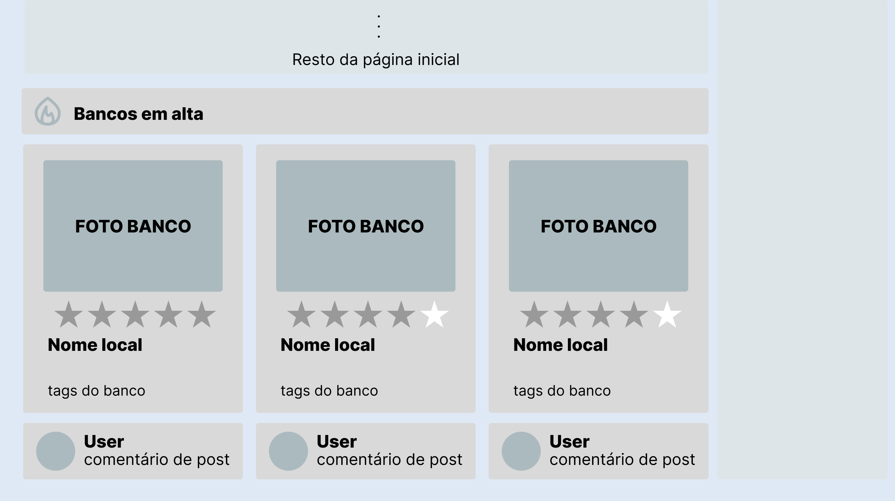

# Interfaces

## Interface 1: Página de Usuário
[pagina usuario](https://github.com/Segohui/Dados-de-Bancos---DB/blob/main/imagensPaginas/imagem_PaginaUser.png)

### Relevância
  Para qualquer site com funçãoi de ser uma rede social que se preza necessita de uma págia de usuário, onde seja possivel criar uma presença tangível no app. A escolha de demonstrar de forma clara e processada as avaliações que um usuário tenha feito é vital para um outro usuário qualquer seja capaz de ter uma ideia da forma que o avaliador escolhe avaliar os bancos juntamente com o quão crítico ele é em suas avaliações.

## Interface 2: Tela para Moderadores
[(Moderação)](https://github.com/Segohui/Dados-de-Bancos---DB/blob/main/imagensPaginas/Moderacao.jpg)

### Explicação
  A tela possui duas seções principais, uma que mostra os tickets (manutenções ou sugestões), e a outra que define o filtro para quais aparecem. O filtro pode filtrar tickets por estado (**pendente**, **aprovada**, **rejeitada**), por tag de usuário, pelo tipo (**existe**, **não existe**, **quebrado**, **inacessivel**) e pela data de envio (seleciona todos depois de uma data minima).

### Relevância
  Essa tela é utilizada para o moderador ter acesso aos tickets, sendo importantes para a vericidade dos dados no banco de dados, que são inerentes à mudanças no mundo real. Além disso, os tickets um sentimento de comunidade com a ajuda dos usuários.

## Interface 3: Em alta (query da página principal)

### Explicação
  Um dos módulos da página principal é "Bancos em alta", que destaca os assentos mais relevantes do momento com base no volume de avaliações recentes (o que pode indicar bancos novos, mudanças relevantes etc.). Os três bancos com maior número de novas menções são exibidos em cards na interface, contendo suas informações e um comentário de destaque.

  A query seleciona os 3 bancos que mais receberam avaliações recentemente. Ela começa pegando as 50 últimas avaliações do sistema (número arbitrário que deve ser uma boa amostra) e conta quantas delas pertencem a cada banco, considerando apenas bancos que existem ("nao existe" ou "quebrado" não entram). Em seguida, calcula a nota média de cada banco (considerando todas as suas avaliações, não só as recentes), busca a foto principal, agrupa as tags descritivas e recupera o comentário e o autor mais recentes (informações exibidas na UI). O uso de LEFT JOIN garante que os cards continuem aparecendo mesmo que o banco ainda não tenha fotos, tags ou comentários cadastrados. O resultado final é ordenado do mais avaliado para o menos avaliado, com desempate pela maior nota média.

### Relevância
  Essa funcionalidade apresenta bancos de interesse por um caminho alternativo à localização geográfica, destacando locais que provavelmente vêm despertando a atenção da comunidade recentemente e que, por isso, tendem a ser mais relevantes no momento. Além disso, a seção atua como incentivo direto ao engajamento, o que fomenta a coleta de dados.

## Interface 4: Tela de Ranking
(Imagem.jpg)

### Explicação

### Relevância

## Interface 5: Tela do Assento
(Imagem.jpg)

### Explicação

### Relevância
