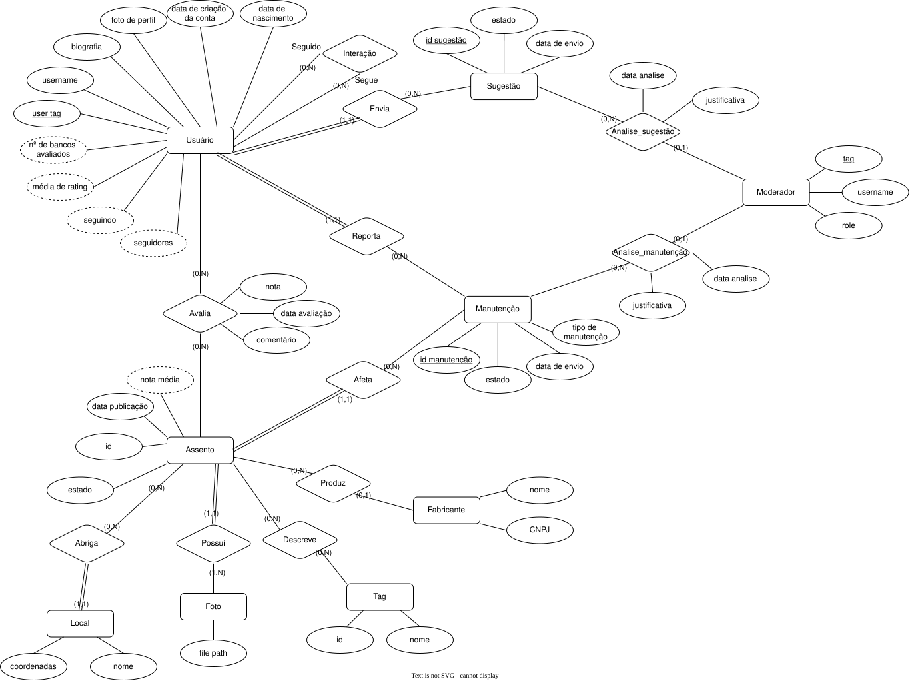

# Modelagem

## Escolha SGBD

O SGBD escolhido foi o SQLlite. O principal motivo para a escolha é a simplicidade do uso, funcionando bem no vscode. Utilizamos o gitgub para sincronizar mudanças de todos os membros por um arquivo.sql, com cada um podendo criar um .db localmente com o sqlite3.

## Modelagem Lógica

## Justificativa para Decisões de Modelagem e Implementação
### Usuário
  Para a criação da TABLE de usuário, escolhemos dedicar ao espaço referente á foto de perfil como um VARCHAR, onde apenas se guardaria o nome do arquivo da imagen, permitindo que no momento de busca para obter a foto seja obtido chamando diretamente ela pelo diretório. A forma seria semelhante à : "/dadosdebanco/imagensUser/"**usuario.foto_perfil_url**".
  
  Alem disso, fizemos a escolha de armazenar no próprio usuário os numeros referentes a cada rate que o usuário deu para cada banco avaliado, permitindo maior controle dos dados individuais, e usar eles para obter o numero de avaliações junto com a média da avaliação usando eles, sem necessitar de duas consultas extras para cada.

### Assento
  O assento foi construido para ter relação com o *local*, *foto*, *fabricante* e *modelo*. Tudo que é preciso saber sobre dado assento no mundo real (fora as avaliações) está nessas entidades e em suas relações. Em específico, os estados em que assentos podem estar são 4, e são verificados logo em sua criação (Eles sendo: **existe**, **nao existe**, **quebrado**, **inacessivel**).

### Remodelação da linha Assento -> Modelo -> Fabricante
  No primeiro diagrama feito para esse banco de dados, a relação entre Assento, Modelo e fabricante era confusa, seguindo uma cadeia de assento à fabridante, não ficando claro o que era o modelo em si, como ele era ligado ao fabricante. Agora, o modelo e fabricante tem relação somente com o assento, com o modelo servindo somente para descrever as caracteristicas fisicas do banco.

### Moderador
  O moderador foi feito como uma entidade própria, independente de *usuário*, com *mod_tag* (chave primária), *username* e *role*. Ele só existe para analisar tickets então não precisa de perfil, seguidores nem avaliações. O *role* é um VARCHAR com valor padrão 'moderador', o que permite criar "papéis" sem alterar o esquema.

### Manutenção
  A *manutenção* (pedido para mudar a situação do banco no site) se liga no diagrama a três relacionamentos: *Afeta* (assento), *Reporta* (usuário que abriu o pedido) e *Analisa* (moderador que decidiu). Como todos eles são 1:N, escolhemos não criar tabelas separadas para *Reporta* e *Analisa* e guardar essas informações direto na tabela **manutencao**, com as colunas *user_tag*, *mod_tag*, *data_analise* e *justificativa*.

  As colunas da análise ficam NULL enquanto o pedido está 'pendente' e são preenchidas com um UPDATE quando o moderador decide. Assim temos menos tabelas e evitamos JOINs extras. O mesmo foi feito na *sugestão*, que também recebe *mod_tag*, *data_analise* e *justificativa*.

### Sugestão
  A *sugestão* (pedido para cadastrar um banco novo no site) não aponta para um assento, já que ele ainda não existe. Por isso, a tabela **sugestao** guarda o *nome_local* (chave estrangeira para **localizacao**), o *estado_assento* informado pelo usuário e as *coordenadas*, que são opcionais. O *user_tag* de quem enviou é obrigatório.

  Assim como na *manutenção*, não criamos uma tabela separada para a análise: *mod_tag*, *data_analise* e *justificativa* ficam na própria **sugestao**, como NULL enquanto o estado é 'pendente', e são preenchidas com um UPDATE quando o moderador decide.

### Avaliação
  A *avaliação* é a relação entre *usuário* e *assento*, então virou a tabela **avalia**, com os atributos *nota*, *data_avaliacao* e *comentario* (opcional). A chave primária é composta por (*user_tag*, *id_assento*), o que garante que cada usuário avalie um banco uma única vez, e a *nota* é limitada de 1 a 5 por um CHECK.

  A nota média do assento não é guardada: ela é calculada com AVG sobre **avalia** quando necessário, o que a mantém sempre atualizada.